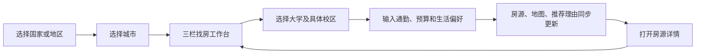

# 产品流程与三栏交互

日期：2026-09-21。用户已确认实景三维城市效果。本文是产品设计，不是现有网站的行为说明。

## 1. 用户与范围

主要用户是准备出国上学的学生。核心决策是：在可接受预算和租期内，找到靠近**具体校区**、生活方便、信息可信的住所。

首批目的地限定为英国、澳大利亚、新加坡、马来西亚、中国香港。界面使用“国家/地区”标签，内部用 GB、AU、SG、MY、HK 管理市场配置。

本阶段主要解决发现、筛选和理解房源。支付、合同签署、租客身份审核、房东后台、预约看房等属于后续独立需求，不应成为第一版找房体验的前置条件。

## 2. 进入流程



城市选择后即可进入工作台，校区选择嵌在顶部或对话里，不增加强制的第三层欢迎页面。未选校区时仍可按城市浏览，但不显示虚构的上学通勤时间。

建议城市目录如下；它是产品规划，不表示这些城市已有房源或三维数据接入：

| 国家/地区 | 建议首批城市/搜索区域 | 处理方式 |
| --- | --- | --- |
| 英国 | 伦敦、曼彻斯特、伯明翰、爱丁堡 | 一所大学可关联多个校区；苏格兰安全数据需单独适配 |
| 澳大利亚 | 悉尼、墨尔本、布里斯班、珀斯、阿德莱德 | 注意跨城校区和较大的通勤范围 |
| 新加坡 | 新加坡 | 保留第二步确认城市，随后选校区或片区；不伪造多个城市 |
| 马来西亚 | 吉隆坡、梳邦再也、乔治市、新山 | 城市与都市圈可分开建模，大学地址与搜索边界分别存储 |
| 中国香港 | 香港 | 第二步城市为香港，港岛、九龙、新界作为区域筛选 |

没有可用房源的城市显示“暂未收录房源”，可展示城市和学校资料；不使用其他城市房源凑数。

## 3. 桌面工作台

```text
┌──────────────────────────────────────────────────────────────────┐
│ 国家/地区 · 城市    大学/校区    预算 · 入住日期 · 租期              │
├─────────────────┬───────────────────────────┬────────────────────┤
│ 房源数量、排序   │                           │ 找房助手           │
│                 │     可旋转的实景城市      │ 已理解的条件       │
│ [← 图片 1/5 →]  │                           │                    │
│ 房名 · 房型     │  房源价格标注 · 大学校区   │ 推荐房源与理由     │
│ £xxx / 人 / 周  │  30 分钟步行范围          │ 数据不足提示       │
│ 通勤 · 配套     │  路线 · 超市/商场         │                    │
│ [地图定位]      │                           │ 可点击房源引用     │
│ [查看详情]      │ [缩放][旋转][俯仰][复位] │                    │
│ ……独立滚动     │ [搜索此区域]              │ [输入需求……][发送]│
└─────────────────┴───────────────────────────┴────────────────────┘
```

建议宽度：左侧 340–400px、右侧 320–380px，中间使用剩余空间。在 1440px 桌面上预留足够地图面积；窄屏允许收起聊天。实际尺寸需通过原型验证，不固定为三个等宽栏目。

左侧、右侧分别滚动，地图保持视口高度。顶部常驻条件标签，例如“UCL 某校区”“步行 ≤30 分钟”“£300/人/周以内”。标签变化必须来自用户操作或可见的对话条件更新。

## 4. 房源卡片和详情

每张卡片至少显示：图片轮播、名称、区域、房型、价格及币种、每人/整套、每周/月、可入住日期，以及有依据的通勤时间。展示“起价”时说明对应房型、租期及费用是否齐全。

图片左右箭头、手势和页码属于独立控件，不触发卡片导航；图片尚未加载、图片缺失时保留固定占位和说明。轮播不自动播放。

为了同时满足“点击房子在地图显示”和“可以进入详情”，建议明确划分点击行为：

| 操作 | 列表 | 地图 | 详情/聊天 |
| --- | --- | --- | --- |
| 点击卡片空白区或“地图定位” | 选中房源 | 平滑移动、高亮标注、显示简要弹窗 | 保留当前聊天 |
| 点击标题或“查看详情” | 保留选中及滚动位置 | 记住镜头 | 打开可分享的详情路由 |
| 点击地图标注 | 滚动到对应卡片 | 高亮该标注 | 可从弹窗查看详情 |
| 点击聊天中的房源引用 | 选中对应卡片 | 同步定位 | 高亮被引用的推荐理由 |
| 返回详情上一页 | 恢复滚动和筛选 | 恢复镜头 | 恢复会话 |
| 横向切换图片 | 只改变该卡片图片 | 不移动 | 不跳转 |

交互设计采用显式选择后定位，不在鼠标每次经过卡片时飞行，避免浏览列表时地图不停跳动。

详情页以可租的房型/报价为核心：相册、房型、面积及单位、独立/共用卫浴、租期、入住日期、原币价格、押金、已知费用、账单包含项、地址精度、到校路线、周边配套、信息来源与核验日期。楼盘有多个房型时，不能让整栋楼的最低价看起来适用于每一个房间。

## 5. 地图需要支持的内容

- 操作：缩放、拖动、旋转、俯仰、指北、复位；提供可见按钮，不只依赖隐藏的鼠标手势。
- 图层：带真实纹理的城市三维实景、房源、大学/校区、步行可达范围、选中房源到校路线、超市/商场。
- 实景须同时有三维结构与真实外观纹理；目标区域缺数据时标注覆盖限制。轻量备用模式不算达到实景验收要求。
- 不同房型或报价位于同一建筑时聚合标注，展开后选择；相邻建筑不叠成无法点击的价格标签。
- 用户移动地图后显示“搜索此区域”，确认后才改变查询范围。镜头位置和业务筛选范围分开，AI 定位房源不会意外缩小结果集。
- 更换城市时清除旧城的校区、房源选中、可达范围及路线，并对未适用于新城市的预算币种提示重新选择。

## 6. 对话体验

用户：“我想离大学走路 30 分钟内，住在比较安全的地方，购物方便。”

系统先检查有没有明确校区。如果没有，问“你要去哪所大学、哪个校区？”并给出本城市匹配项。如果只有预算缺失，可以先列出符合已知条件的房源，同时询问预算，不把缺预算变成无法看房。

确定校区后：

1. 显示“正在计算步行范围”“正在核对房源及附近超市”等真实进度。
2. 更新条件标签、左侧房源和地图范围。
3. 用实际结果说明“到校约 24 分钟；最近超市约 7 分钟；区域资料来自某来源、统计期为某时间”。这些数字只能来自工具结果；这里的数字仅为文案示例。
4. 安全资料缺失时显示“缺少足够的街区级资料”，不把配套齐全替换为“安全”。
5. 用户说“再便宜一点”，只修改预算/排序；保留校区和步行上限，展示变化后的条件。
6. 没有严格符合的房源时说明哪个条件限制最大。可提出扩大到 40 分钟等选项，用户选择后才放宽。

回答里的房源引用必须能定位到真实 `listingId/offerId`；聊天不能编造列表里不存在的房源、价格或剩余数量。

## 7. 手机与异常情况

手机用“房源 / 地图 / 助手”三个切换页共用同一状态；房源详情仍可直接访问。平板可采用列表＋地图，聊天从侧边展开。

| 情况 | 用户应看到的行为 |
| --- | --- |
| 地图或三维资源加载失败 | 保留列表和筛选；给出重试或 2D 模式 |
| 没有 WebGL 能力 | 使用可用的静态地图/位置链接，核心找房不失效 |
| 步行接口失败 | 时间显示“暂无法核实”；不能拿直线距离冒充步行时间 |
| AI 接口失败 | 保留已应用条件，可继续用表单筛选 |
| 房源下架或报价过期 | 详情标注状态，不继续当作当前可租结果 |
| 多轮请求乱序 | 只应用最新版本筛选，旧结果不覆盖新城市/新预算 |
| 键盘/读屏操作 | 轮播、卡片、标签、地图控件和聊天可访问；地图结果同时有文字列表 |

## 8. 首版范围的明确划分

必须做：五个国家/地区入口、城市选择、三栏页面、图片轮播、列表地图双向选择、独立详情页、明确校区、真实步行筛选、配套说明、自然语言条件解析和结果解释。

逐城市核查：实景覆盖与纹理质量、可核实的区域安全参考；达到要求的城市才标为实景已就绪，不能因数据缺失伪造一致覆盖。

已确认：实景三维是主体验要求。待后续确认：最终视觉品牌、真实房源供应方和商业数据渠道。交互原型可使用有明确标识的演示房源，底图仍须使用真实实景数据。
