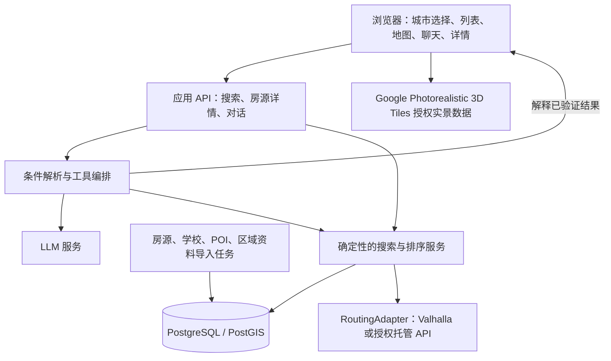

# 技术架构与 AI 找房流程

日期：2026-09-21。用户已明确实景三维效果；主地图选型更新为 CesiumJS + Google Photorealistic 3D Tiles。下列接口为草案，尚未完成集成测试。

2026-10-09 补充：AI 编排已针对当前五城样本重新核对六个开源项目，具体推荐及版本依据见 [Agent 框架选型](13-agent-framework-selection.md)。原有长期架构表仍为规划，不代表数据库和 Agent 已实现。

## 1. 技术选型结论

| 模块 | 首选 | 选择理由 | 何时换方案 |
| --- | --- | --- | --- |
| 页面及详情路由 | React + TypeScript + Next.js | 工作台交互和可索引的房源详情可共存 | 若只验证地图交互，可先用 Vite；不因此形成两个长期前端 |
| 实景找房地图 | CesiumJS + Google Photorealistic 3D Tiles | 按已确认需求显示真实城市纹理，再叠加房源、路线与价格标记 | 目标区域缺覆盖时评估其他授权实景数据源 |
| 共享交互状态 | Zustand + URL 查询参数 | 同步列表、地图、聊天，支持返回与分享 | 不需要复杂跨会话工作流时不增加更多状态框架 |
| 图片轮播 | Embla Carousel | 适合卡片横向切换与触摸操作 | 使用已有等价可访问组件也可 |
| 地理数据 | PostgreSQL + PostGIS | 城市边界、房源点、POI、范围与空间索引 | 不用向量数据库代替空间查询 |
| 步行路由 | Valhalla | pedestrian、反向等时圈、矩阵、单条路线 | 托管服务加快起步；地区特殊路线可通过适配器补充 |
| AI 编排 | AI SDK + Schema 校验 | 流式输出及结构化工具调用 | 首版无需引入 LangGraph 的长流程状态管理 |
| 聊天 UI | 基础 React 组件或 assistant-ui | 快速呈现消息、工具进度和房源引用 | 避免同时使用两套聊天状态管理 |
| 实景数据接入 | Google Map Tiles API 或 Cesium ion 授权渠道，原型择一 | 直接流式加载实景三维；密钥、计费和署名按所选渠道处理 | PMTiles/Martin 不作为 Google 实景数据的自建缓存方案 |
| 图片 | 自有对象存储 + CDN | 尺寸变体、来源管理、失效处理 | 房源方 CDN 允许热链时可按其协议使用 |

选择依据见 [GitHub 对照](02-github-projects.md)。MapLibre、Cesium 是渲染器；它们不提供可租库存，也不自动提供步行图或区域安全信息。

## 2. 路线对比与已确定的选择

| 比较项 | A：MapLibre 立体楼宇 | B：Cesium + 3D Tiles |
| --- | --- | --- |
| 效果 | 建筑轮廓向上挤出，真实或估计高度 | 三维模型、地形、摄影测量纹理等，效果由数据决定 |
| 能否缩放/拖动/转视角 | 能 | 能 |
| 建筑纹理/完整实景 | 挤出方案本身不提供 | 数据具备时支持 |
| 房源与筛选图层 | 直接叠加 GeoJSON/MVT | 需处理三维坐标、地形贴合、深度与遮挡 |
| 移动设备 | 预计更容易控制资源，仍需实测 | 通常需更严格控制三维瓦片与显存，仍需实测 |
| 数据覆盖 | 依赖建筑轮廓、高度、矢量瓦片 schema | 依赖授权的目标区域三维数据 |
| 本项目决定 | 挤出方案不满足已确认效果；保留研究记录 | 首版主路线，加载带真实纹理的数据，先做一城验证 |

MapLibre 也可以通过自定义图层等方式接入复杂三维，本表比较的是建议采用的实现方式，不是声称它只能做挤出。Cesium 也能显示简单建筑；选了 Cesium 不代表自动拥有所有城市实景。

依据：[MapLibre 立体建筑示例](https://maplibre.org/maplibre-gl-js/docs/examples/display-buildings-in-3d/)、[CesiumJS](https://github.com/CesiumGS/cesium)、[Google 3D Tiles 概览](https://developers.google.com/maps/documentation/tile/3d-tiles-overview)。

工程上定义一个小范围地图适配接口即可：`focusListing`、`fitResults`、`setListings`、`setCampus`、`setIsochrone`、`setRoute`。第一版实现 Cesium 主引擎，不同时维护两个全功能渲染器。保留接口是为了后续更换时不改房源和对话业务。

## 3. 系统边界



前端地图可以使用受来源限制的公开地图 token；LLM 密钥、数据库凭据、房源供应方私密密钥只放服务器。地图瓦片、路径计算、房源查询分别有配额与故障处理。

建议先用一个应用后端加一个数据库，路由引擎独立运行或用托管 API。Valhalla 的图构建和地理导入放在长期运行的服务/任务环境，不放进短时限前端边缘函数。托管平台需支持流式响应，限制每次对话时长和工具调用数量。

## 4. AI 如何执行一次找房

AI 的职责：理解需求、询问关键歧义、调用受约束的查询工具、解释结果。数据库和路由服务负责事实与计算。

### 4.1 解析成结构化条件

以下为**示例合同，不是真实用户数据或已测通 API**：

```json
{
  "searchVersion": 4,
  "marketCode": "GB",
  "cityId": "london",
  "campusId": null,
  "commute": { "mode": "walk", "maxMinutes": 30, "direction": "home_to_campus" },
  "budget": null,
  "moveIn": null,
  "leaseWeeks": null,
  "preferences": {
    "safetyContext": "important",
    "shopping": ["supermarket", "shopping_mall"]
  },
  "clarificationNeeded": ["campusId"]
}
```

“离大学”没有明确对象时不能擅自选择城市里最知名的大学。校区不能只根据 LLM 记忆给坐标；应解析为已验证的校区 ID，并选择入口。

预算还要包含 `currency`、`amountMinor`、`period`、`basis`。例如 £300/人/周与 £300/套/月不能进入同一比较。用户只说“3000”时，应追问币种/周期，或明确展示待确认的假设，不静默套用。

### 4.2 查询步骤

1. **解析校区**：用城市内的学校别名表给出候选；用户确定一个校区/入口后再计算通勤。
2. **检查可用房型和报价**：城市、预算、入住日期、租期等硬条件先在数据库执行。
3. **取反向步行等时圈**：目标是“从房源走到学校”，因此在校区入口用反向扩展；多个可用入口取相应可达范围的并集。[反向等时圈文档](https://valhalla.github.io/valhalla/api/isochrone/)
4. **空间候选筛选**：使用保守外包范围缩小查询。等时圈是网格近似，不能仅用简化多边形把边缘可达房源永久排除。可在与路由 profile 一致的最大速度上界构成的保守范围内查候选，再用等时圈优先安排计算。
5. **时间矩阵复核**：对候选房源入口 → 有效校区入口计算步行时间，取满足开放规则的最短可行路线。`durationSeconds <= 1800` 才算满足 30 分钟。
6. **周边设施**：先用空间索引找到候选超市，再计算房源入口到设施入口的步行时间；用经过验证的候选说明便利程度。
7. **区域资料**：按合适的统计区域关联安全资料，返回来源、统计期、地域粒度和缺失状态。
8. **排序**：先满足硬条件，再按用户偏好排；展示每个房源的实际匹配与不足。
9. **返回统一结果**：列表、地图和对话消费同一个 `searchResultId/searchVersion`，模型根据这些结果生成解释。
10. **选中后取详细路线**：不为所有房源请求完整道路几何，选中一个再加载。

矩阵按服务上限分批。若预算只允许先计算部分候选，结果标注“已核实的候选”，不可称为全城最优、不可把未计算房源计为不符合。结果总数和排序覆盖范围必须与实际处理范围一致。

### 4.3 配套与安全如何参与排序

“购物方便”先采用可解释的规则，例如“优先超市步行 10 分钟内”，阈值在界面可见、可改；购物中心与日常超市分开展示，距离接近不等于正在营业。

“安全”首版不进入一个跨国统一综合分。若某城市已有可比较、统计期一致的数据，先呈现区域参考和解释；后续再验证是否适合在同城、同口径数据中参与排序。

排序草案可使用通勤、预算、购物三个归一化特征。权重是产品假设，需要实测与用户反馈；未知值单独输出，不作为 0 分或“最安全”。对硬要求依赖的数据缺失，标注“该条件未验证”，不能列为严格满足。

### 4.4 受约束工具

| 工具 | 输入 | 输出/限制 |
| --- | --- | --- |
| `resolveCampus` | 当前市场、城市、学校文字 | 已登记的校区候选和歧义 |
| `searchListings` | 校验后的搜索条件 | 本次结果 ID、版本、有效报价、证据 |
| `getWalkingRoute` | 房源 ID、校区 ID、入口 ID | 模型估算时间、路线、引擎/图版本 |
| `getAmenities` | 房源 ID、设施类别 | 设施位置、来源及有无路线复核 |
| `getAreaContext` | 房源 ID | 区域资料或明确缺失 |
| `focusListing` | 当前结果中的房源 ID | 浏览器定位结果，不接受任意脚本 |

搜索工具内部完成范围与矩阵计算，模型不自由拼 SQL，也不自行构造无限路由请求。来自房源描述、供应商文本的内容是数据，不是可改变工具权限的指令。所有 ID、坐标边界、城市归属、金额范围、`searchVersion` 都在服务端验证。

Cesium 官方 AI 模板提供了工具注册和浏览器执行的参考；本项目不需要把模板中的任意代码生成、外部 MCP 连接能力一起引入。用有限工具就能完成找房流程。[模板](https://github.com/CesiumGS/cesiumjs-ai-starter-app)

## 5. 数据模型

| 实体 | 核心字段 | 关键原因 |
| --- | --- | --- |
| `markets` | code、名称、币种、时区配置 | SG/HK 可复用城市模型，市场和主权国家概念分开 |
| `cities` | market、name、slug、boundary、cameraPreset、capabilities | 每城数据就绪程度可独立配置 |
| `universities` / `campuses` | aliases、city、来源、入口及开放信息 | 多校区与中文别名，防止错定位 |
| `properties` | 建筑/地址、geom、入口、locationAccuracy | 同一楼盘不等于同一间可租房 |
| `units` / `room_types` | 卫浴、合租方式、面积、occupancy | 学生公寓房型独立 |
| `offers` | source、unit、币种、金额、周期、每人/整套、起止日期、库存状态 | 真正可比较和展示的是报价 |
| `fees` | 押金、一次性费用、账单、已知/未知 | 总成本不能把未知费用按零处理 |
| `media` | URL、alt、排序、授权来源、原始归属 | 图片轮播和授权管理 |
| `pois` | category、geom、入口、营业信息、来源、更新时间 | 购物配套与新鲜度 |
| `area_statistics` | 边界、指标定义、统计期、分母、覆盖状态、来源 | 区域安全参考不假装是楼栋级结论 |
| `route_cache` | 起终点、方向、profile、引擎/路网版本、时间、结果 | 更换入口/路线图后不能复用旧缓存 |
| `search_sessions` | owner/session、条件、版本、结果快照 | 多轮对话、乱序保护、可恢复状态 |

地理坐标统一为 WGS84（EPSG:4326），GeoJSON 使用 `[经度, 纬度]`；每个路由适配器显式转换服务需要的字段。距离单位计算用 geography 或合适的投影，不能把经纬度“度”当作“米”。

空间索引示意：

```sql
-- 设计示意，非本项目已执行的迁移。
CREATE INDEX properties_geog_idx ON properties USING GIST (geog);

-- 只做候选预筛；这个查询不能证明 30 分钟内步行可达。
SELECT id
FROM properties
WHERE city_id = $1
  AND ST_DWithin(geog, $2::geography, $3);
```

`ST_DWithin(geography, geography, meters)` 可利用空间索引。[PostGIS 官方文档](https://postgis.net/docs/ST_DWithin.html)

金额存最小货币单位的整数，禁止用浮点直接累计费用。周租转展示月均价可以使用 `周租 × 52 ÷ 12`，但标注为估算；合同的实际计费周数和起止日期仍以供应方报价为准。不用 `周租 × 4` 伪装月租。人民币换算是可选参考，必须带汇率来源和时间，不覆盖原币价格。

地址不够精确时存 `locationAccuracy`，仅展示近似位置和“通勤待确认”；不得从街区中心算一个时间后声称是房源门口。

## 6. API 与联动状态

建议接口：

| API | 用途 |
| --- | --- |
| `GET /api/markets`、`GET /api/cities?market=GB` | 目的地及数据能力 |
| `GET /api/campuses?cityId=...&q=...` | 校区/入口解析 |
| `POST /api/search` | 表单与 AI 共用的确定性查询 |
| `GET /api/listings/:id` | 房源及有效报价详情 |
| `POST /api/routes/walk` | 已选房源到校区的路线 |
| `POST /api/chat` | 流式条件澄清与推荐解释 |

搜索响应至少包含 `searchVersion`、`resultId`、`appliedFilters`、`listings`、`mapFeatures`、`evidence`、`warnings`、`coverage`。地图中的 ID 必须能对应同一结果集；多房型在一个建筑聚合时保留子报价 ID。

共享状态示意：

```ts
type SearchState = {
  marketCode: 'GB' | 'AU' | 'SG' | 'MY' | 'HK';
  cityId: string;
  campusId: string | null;
  filters: SearchFilters;
  resultId: string | null;
  searchVersion: number;
  selectedListingId: string | null;
  hoveredListingId: string | null;
  searchBounds: Bounds | null;
  camera: CameraState;
};
```

`SearchFilters/Bounds/CameraState` 是待实现类型，不是已存在代码。筛选持久化到 URL；原始聊天内容、个人信息不放 URL。地图实例与图片索引留在客户端。SSR 下状态按请求/会话隔离，避免跨用户共享。

更新筛选先递增版本、取消旧请求；流式事件带会话和版本，前端忽略旧事件。模型的文字说明只能引用已生效的结果版本。

## 7. 性能、可靠性和运行成本

- Cesium 按需加载，Viewer 实例只创建一次；流式聊天消息不能重建地图。大批房源使用合适的实体/Primitive 集合与聚合策略，避免数千 DOM 标记。按设备控制三维细节层级、分辨率和可见对象。
- 首屏优先加载卡片第一张缩略图，后续图片按交互加载；长列表分页或虚拟化。
- 城市级 POI 提前导入，大学入口先整理。可达范围和路线缓存须考虑供应方许可、路网版本和开放条件。
- 普通镜头拖动不触发 LLM。确定性筛选、价格排序、分页都直接调用业务服务。
- 每会话设最大工具次数、超时、候选矩阵规模和取消机制；失败时不留下“筛选成功”的假状态。
- 地图令牌限制来源域名和权限；后端私密 key 不进入 `NEXT_PUBLIC_*` 或 `VITE_*`。
- 日志记录请求耗时、路由次数、数据版本和模型成本；默认不记录完整私密对话。

实景纹理、连续覆盖、标注遮挡、路线贴合、实际帧率、路由精度和部署成本必须在样本城市与目标设备上测量。详细视觉验收见 [实景三维城市方案](07-photorealistic-city.md)。开源许可证不等于地图数据、托管服务或模型调用免费。
