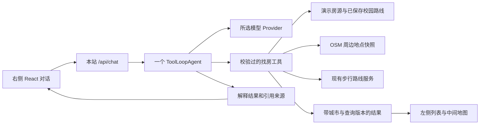

# 租房对话 Agent 选型（2026-10-09）

## 结论

建议首版采用 **Vercel AI SDK 7 的 `ToolLoopAgent` + `@ai-sdk/react` + 所选模型的 Provider**，保留现有对话界面，由一个找房 Agent 调用受约束的业务工具。用户进一步明确未来部署普通服务器、必须支持多轮对话和地图联动；推荐保持 AI SDK，服务器侧增加持久会话及结构化查询状态。当前 workerd 只是样本运行环境，选型不依赖该平台，也不是所有 Agent 产品的通用排名。

当前需求是多轮理解预算、房型和通勤偏好，再查询现有房源、校园路线及周边地点，并同步地图。暂时不需要多 Agent 分工、长任务调度、代码执行或向量数据库。这里的“轻量”主要指需要引入的业务抽象和运行服务少；没有进行各框架运行内存、延迟或生产压缩包大小的横向基准测试。

来源：[GitHub 仓库](https://github.com/vercel/ai)、[Agent 概览](https://ai-sdk.dev/docs/agents/overview)、[React 对话接口](https://ai-sdk.dev/docs/ai-sdk-ui/chatbot)。公开代码使用 Apache-2.0；模型推理和部署资源另行按供应商计费。AI SDK 可以直接使用模型 Provider，不要求部署在 Vercel，也不强制使用 Vercel AI Gateway。

## 实际检查了哪些项目

以下数据是本轮 GitHub API / npm 快照，精确检查时间、默认分支 SHA、原始元数据见 `evidence/agent-frameworks/manifest.json`。六个仓库均未归档，默认分支提交时间在 2026-10-06 至 2026-10-09。Star 仅反映关注度；选型同时看许可、正式发布、文档、工具执行方式和现有工程适配。

| 项目 | 快照 Star / 版本 | 已核对的能力与许可 | 对本项目的判断 |
| --- | --- | --- | --- |
| [Vercel AI SDK](https://github.com/vercel/ai) | 27,192 / `ai` 7.0.136 | 工具循环、Schema、流式输出、React hooks、多 Provider；Apache-2.0 | **首选**。在现有应用内增加对话 API 和工具，不需要另启一套 Agent 平台 |
| [OpenAI Agents SDK JS](https://github.com/openai/openai-agents-js) | 3,902 / 0.20.0 | Agent / Runner / tool、会话、guardrails、tracing、handoff；MIT | **备选**。若明确优先 OpenAI 原生会话、追踪或语音，值得采用；当前需要处理 Zod 4 依赖和 Workers 运行限制 |
| [Mastra](https://github.com/mastra-ai/mastra) | 28,655 / `@mastra/core` 1.75.0 | 工具、记忆、工作流、评估与 Studio；主体 Apache-2.0，`ee/` 有独立企业许可 | 能完成需求。当前用不上其大部分平台能力，首版引入的依赖和概念更多；未来做完整 Agent 产品平台可重评 |
| [LangGraph JS](https://github.com/langchain-ai/langgraphjs) | 3,341 / 1.4.21 | 图状态、持久执行、检查点、人工介入、流式输出；MIT | 更适合可恢复的长流程。官方也将它定位为编排运行时；当前简单找房工具循环可先不引入 |
| [Cloudflare Agents](https://github.com/cloudflare/agents) | 5,797 / `agents` 0.27.0 | Durable Objects 持久状态、WebSocket 同步、调度、聊天扩展；MIT | 如果以后需要离线继续运行、定时找房或跨设备持久会话，较匹配；目前要新增 DO 绑定与迁移，部署耦合更多 |
| [Hugging Face smolagents](https://github.com/huggingface/smolagents) | 29,745 / 本轮未核对 PyPI 版本 | Python，CodeAgent 与 JSON 工具调用 Agent；Apache-2.0。参考文档仍标注 API 实验性 | 内核简洁，但当前 TypeScript 网站需要额外 Python 后端。首版不采用代码执行型 Agent 来查询固定租房工具 |

Mastra 不能仅凭 npm 的 Apache 标识忽略仓库 `ee/` 许可：已读取 [许可映射](https://github.com/mastra-ai/mastra/blob/main/LICENSE.md)。GitHub API 对 AI SDK、Mastra 返回 `NOASSERTION`，本轮用许可证正文核对，未据此误判为无许可。

OpenAI SDK 可运行于 Workers，但[官方明确列出限制](https://openai.github.io/openai-agents-js/guides/troubleshooting/)：需要 `nodejs_compat`，追踪需在请求末尾主动 flush，部分追踪上下文受运行时限制。它可以通过适配器扩展其他模型，不应描述成只能调用 OpenAI。

Cloudflare 的[聊天扩展](https://github.com/cloudflare/agents/tree/main/packages/ai-chat)建立在 AI SDK 和 Durable Objects 上；新项目应区分 `@cloudflare/ai-chat` / `@cloudflare/think` 与已弃用的旧聊天入口。AI SDK 与 Cloudflare Agents 不互斥，后者可在确有持久执行需求时再增加。

## 与当前工程的兼容性证据

本地已读取 `app/package.json`，并确认安装的 Zod 为 3.25.76；现有 React 为 19.2.6，工程 Node 要求为 22.13+。本轮没有安装或升级应用依赖。

| 候选依赖 | 本轮正式发布快照 | 已核对的声明 |
| --- | --- | --- |
| `ai` | 7.0.136 | Node >=22；Zod `^3.25.76 || ^4.1.8` |
| `@ai-sdk/react` | 4.0.139 | Node >=22；支持 React `^19.2.1`；依赖 `ai` 7.0.136 |
| `@ai-sdk/openai` | 4.0.91 | Node >=22；Zod `^3.25.76 || ^4.1.8`。仅在选定 OpenAI Provider 时需要 |
| `@openai/agents` | 0.20.0 | Zod `^4.0.0`，不是当前根依赖版本 |

以上只能证明 Node / React / Zod 的版本声明相符，不能替代 TypeScript 5.9、vinext、workerd 中的实际安装、编译和流式运行验收。AI SDK 的 npm 发布包及 React 包已只读下载，SHA-512 与 npm integrity 匹配；提取的源码和版本内文档保存在 `published-ai-7.0.136/` 与 `published-ai-sdk__react-4.0.139/`，没有执行下载的代码。

检查正式发布源码后确认：`ToolLoopAgent`、`createAgentUIStreamResponse`、`inputSchema` 和 `useChat` 是当前路线；SDK 7 的步骤限制使用 `isStepCount`。后续实现应锁定互相兼容的正式版本和 lockfile，不套用旧教程中的 `maxSteps`、旧版 `useChat` 参数，也不混用 SDK 6 的 `stepCountIs` 名称。

## 这个网站的 Agent 怎样工作

下表是**待实现的工具设计**，不是已经接通的 Agent 功能：

| 工具 | 负责什么 | 可复用的数据或代码 |
| --- | --- | --- |
| `searchListings` | 按同城预算、房型、含账单筛选，返回有效房源 ID | `lib/rental-data.ts`、`lib/assistant.ts` 的确定性筛选逻辑 |
| `getCampusCommutes` | 查询已有校园步行路线，程序按实际时长筛选“30 分钟内” | `public/routes/` 中三十条保存路线；每城六套演示房源 |
| `findNearbyAmenities` | 查公寓附近的指定设施、距离、菜系，返回少量候选和来源 | `public/amenities/`、`lib/amenities.ts`；共 15,726 条记录 |
| `planWalkingRoute` | 按有效公寓与地点 ID 查询真实步行路线和时间 | `lib/amenity-route-server.ts`；校园目的地优先用保存结果 |
| `presentResults` | 输出列表、选中房源、路线与设施图层的结构化显示指令 | 复用 `rental-explorer.tsx` 和 `city-map.tsx` 的现有交互入口 |

模型负责理解需求、提出必要追问、选择工具并解释；筛选、距离计算、路线时长和地图状态由程序处理。不能让模型凭训练记忆补坐标、路程或安全评分。

例如用户说“UCL 步行三十分钟内，周租三百五十镑以下，附近有超市”：先用预算筛选，再读取候选房源已有通勤结果，用程序按三十分钟筛选，随后查询附近超市；展示房源和设施，并引用具体路线与地点。POI 查询中的直线距离明确保留为直线距离，只有路线服务结果才能称为步行距离或时间。

“安全”当前仍缺可靠区域资料。助手应说明可用证据不足，不把医院、公园、评论或犯罪数据缺失当作安全证明。大学与校区以应用当前已选对象为准，用户改提未支持校区时先说明范围或追问，不能悄悄使用另一校区的保存路线。

工具结果使用受约束的同城 ID；前端只应用已校验、属于当前城市及查询版本的结果，避免切城或新问题发出后旧回复覆盖地图。模型不直接执行浏览器 JavaScript。整批房源和 15,726 条 POI 不全部塞进提示词，工具只返回有用的候选、关键指标和出处。

## 首版接入与验收建议

### 普通服务器、多轮对话和地图联动

建议采用 Node.js 22+ 服务器运行对话 API 与工具，PostgreSQL 保存会话及业务状态，浏览器保留 React 和 Cesium。首版这些服务可以部署在同一台服务器，不要求 Kubernetes、Redis 或独立的 Agent 服务集群。

会话按用户和 conversationId 隔离，保存消息及工具结果；城市、校区、当前公寓、预算、房型、距离范围和最近一次地点结果单独保存为结构化状态。每次对话加载所需历史与当前状态，让“再近一点”“只显示现在营业的”“那最近的一家呢”能够承接上文。营业状态等未接可靠数据时应明确未知，不能只凭语言理解补出事实。刷新或服务器重启后从数据库恢复；不将进程内存或前端 hooks 误作持久记忆。该实现方式有 [AI SDK 官方持久化指南](https://ai-sdk.dev/docs/ai-sdk-ui/chatbot-message-persistence) 可参考。

用户问“我附近有几个便利店”时，建议默认参照当前选中公寓，并明确统计范围，例如直线五百米；没有选定位置时追问，使用用户当前位置另走明确的定位授权流程。`findNearbyAmenities` 根据受校验的位置 ID、类别和范围查询，返回中心、范围口径、完整结果数量、来源时间及门店坐标。计数和地图标记消费同一批结果；传输需要分页时计数仍取完整集合，不把当前页长度当总数。

工具输出通过类型化结果或自定义数据流送到浏览器，前端更新便利店图层、查询范围及镜头。只应用属于当前会话、当前城市和最新查询版本的结果，防止旧请求或历史消息重放覆盖新地图。后续“最近的一家”引用上次结果，“怎么走”调用对应 ID 的步行路线工具。SDK 提供[结构化自定义数据流](https://ai-sdk.dev/docs/ai-sdk-ui/streaming-data)，业务查询、计数及 Cesium 更新仍需实现适配代码。

当前地点数据是五个指定校区周边三公里的保存快照；对范围外的地点，工具应报告未覆盖或改接搜索数据源，不能返回零并声称附近没有便利店。

1. 新增流式 `/api/chat`，用现有 React 面板承载 `useChat`，保留城市、选中公寓和筛选上下文；支持停止、错误提示和重试。
2. 接入上述业务工具；校园通勤优先读取缓存，设施路线遵守已有服务的单并发、至少 1.1 秒间隔及每日请求额度，不对所有 POI 自动重算路线。
3. 对工具入参和结果做 Schema 校验。设置明确的模型步骤上限，例如 `isStepCount(5)`，并单独限制工具次数及实时路线次数；模型步骤上限不等于工具调用次数上限。
4. 在当前城市内验证多轮修改预算、排除房型、通勤筛选、设施查询、地图联动、零结果、切城、取消请求及工具失败。模型密钥仅在服务器配置，不使用公开的 `VITE_` 前缀，也不复用 Cesium token。
5. 按普通服务器目标验收 Node 构建、持久会话和流式工具结果，再检查临时预览所用的 workerd 适配。多轮对话和地图同步必须实测，包括刷新／服务重启后恢复、不同会话隔离、工具失败、迟到结果和分页计数。

框架无需再做一轮开放式选型；下一步需要确定模型供应商及服务器端模型访问配置。使用哪个模型与使用哪个 Agent 框架是两个独立决定。首版继续使用演示房源，不因接上模型而变成可预订库存。

## 证据与验证范围

- 六个候选仓库：真实 GitHub REST 元数据、默认分支提交及二十六个 README / 许可 / 包声明 / 源码或文档文件已保存，全部读取成功，并逐文件复核 SHA-256。
- npm：八个包的当前 `latest` 元数据已保存；两个推荐发布包只读解包并核验完整性。
- 源码证据位于 `evidence/agent-frameworks/`，逐文件 URL、提交 SHA、SHA-256、读取结果见 `inspected-sources.json`；复取脚本位于 `research/scripts/collect_agent_frameworks.py` 与 `collect_agent_sources.py`。
- 这是选型研究；没有改造运行中的对话、没有安装候选框架、没有模型密钥或实际模型调用，尚不能声称新 Agent 已运行或回答质量已通过测试。

补充官方资料：[AI SDK 工具与 UI 联动](https://ai-sdk.dev/docs/ai-sdk-ui/chatbot-tool-usage)、[循环控制](https://ai-sdk.dev/docs/agents/loop-control)、[OpenAI Sessions](https://openai.github.io/openai-agents-js/guides/sessions/)、[Mastra Next.js 集成](https://mastra.ai/integrations/frameworks/next-js)、[LangGraph 定位](https://docs.langchain.com/oss/javascript/langgraph/overview)、[Cloudflare 与 AI SDK](https://developers.cloudflare.com/workers-ai/configuration/ai-sdk/)、[smolagents Agent API 状态](https://github.com/huggingface/smolagents/blob/main/docs/source/en/reference/agents.md)。Cloudflare 文档中的示例 Provider 还需对所选 AI SDK 主版本单独核对，本轮未将旧示例直接视作当前工程已兼容的证明。
