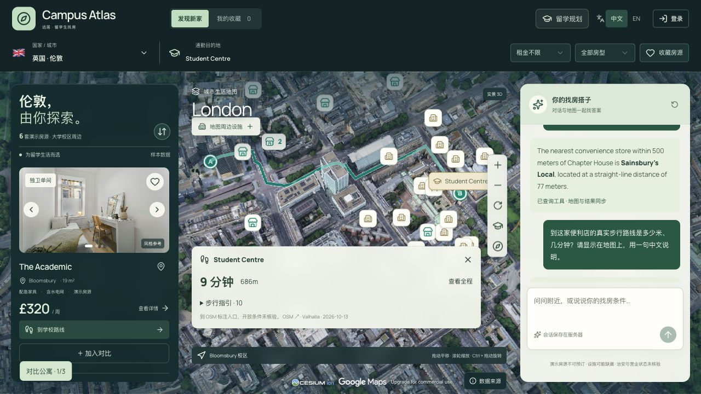

# Campus Atlas 桌面工作区优化建议

日期：2026-10-14。本文是体验审查与下一轮需求建议，尚未实现下列新增交互。

## 本次审查范围与证据

用户目标：找房时可以随时收起房源列表或 AI 助手，获得更大的实景地图，并让现有功能更容易使用。

1. **桌面找房主界面、实景地图与楼栋路线：主体功能可见，信息密度偏高。** 本次新打开当前部署站点，在 1280 × 720 视口等待三维地图、会话和路线恢复后捕获截图。列表宽 306px，助手宽 310px；房源、路线、设施与校园标记可以同时出现。未观察到水平溢出，未发现桌面左右面板收起入口。

页面：[Campus Atlas](https://campus-atlas-demo.pages.dev/?city=london&listing=london-2)。本地代码基线：`d5c1ef9e3cbd744b4e293d76041ae91f5f0ac2cb`。

截图由本轮浏览器会话采集，并已打开检查；没有使用此前的截图代替本轮证据。本次仅审查桌面主界面，不是完整注册、AI 问答、跨城市地图或无障碍回归测试。

## 当前已有能力

代码核对确认已有收藏、服务器会话恢复、校园楼栋目的地、步行路线、通勤范围、最多三套房源对比、月支出估算、常去地点通勤及房源/目的地分享链接。公交查询保留既有官方规划入口方案。

现有能力应继续完善入口和反馈。收藏目前存在浏览器本地存储；已有的会话恢复和对比链接不等同于可命名、可管理、完整恢复的多套找房方案。

## 第一优先级：面板自由收放

### 交互方案

- 左侧房源、右侧助手独立收起，支持三栏、房源＋地图、地图＋助手、纯地图四种状态。
- 面板标题区放置有文字提示的收起按钮；收起后在地图边缘保留“房源 · 6”和“AI 助手”入口，不能把恢复入口也隐藏。
- 增加“一键专注地图”，再次点击恢复此前布局；提供“恢复默认布局”。
- 记住这台电脑上的面板偏好。手机继续使用现有房源/城市/助手切换，不继承桌面面板宽度。
- 收起时保留聊天历史、未发送草稿、进行中的请求、列表滚动位置、所选房源、筛选和地图视角。
- 助手收起期间可以完成回复，完成后显示轻量提示点，不强行展开；地图联动结果保留明确的“查看地图”入口。
- 收放约 180–220ms，支持减少动态效果；恢复按钮可通过键盘操作，并有清晰焦点样式。

### 验收项

1. 四种布局均可恢复，连续开合不会丢失状态或重新创建三维地图。
2. 地图设施入口、路线卡片、相机控制和署名跟随可用空间调整，不能仍留在原来的固定侧栏偏移位置。
3. 打开面板不会把当前目的地、关键路线或恢复入口完全盖住；地图朝向、倾角不被无故重置。
4. 输入中、AI 回复中、查看楼栋路线中分别执行开合，状态均保留。
5. 中文、英文，以及桌面窄窗口、宽窗口和手机断点均核对；隐藏面板中的控件不可继续被 Tab 聚焦。

## 后续优先级

| 优先级 | 建议 | 具体行为与收益 | 现有基础 / 条件 |
| --- | --- | --- | --- |
| P0 | 房源列表与地图双向联动 | 悬停卡片突出对应地图标记；点击地图房源时，让对应卡片进入可见区域；提供“回到已选房源” | 已有点击定位，增强关联反馈 |
| P0 | 地图标记分层 | 重点显示所选房源、路线终点及被问到的设施；其他楼栋按视距、相关性和重叠程度逐级收纳 | 已有设施聚合与部分标签显隐，需加强楼栋密度控制 |
| P0 | 路线卡片收起 | 可缩成“到 Student Centre · 9 分钟 · 686m”的摘要，展开查看指引 | 截图中路线卡片占据较大地图面积；现有“关闭路线”不等同于保留路线、收起说明 |
| P0 | 统一地图工具入口 | 将周边设施、校园楼栋、通勤范围组织为清晰分组，显示已开启数量，并能一键清空对应图层 | 功能已有，入口分散；收纳后仍要保持当前图层状态可见 |
| P1 | 侧栏宽度可调 | 助手需要阅读长回答时拉宽，浏览房源时让列表更紧凑；限制最小地图空间，支持重置 | 先完成收起/展开，再加入拖动宽度 |
| P1 | 明确的排序菜单 | 显示当前排序，支持租金升/降序、到指定楼栋的时间；总支出排序保留“费用不完整”状态 | 当前主要是价格排序切换；未知费用不得按零处理 |
| P1 | AI 操作结果与撤销 | 显示“已找到 3 家便利店”“已调整预算”等结果卡，提供定位、查看路线和撤销上一次筛选/图层变更 | 已有工具与地图状态联动；新增操作解释与恢复能力 |
| P1 | 保存命名方案 | 将城市、目的楼栋、筛选、收藏/对比房源及视角保存为“UCL 秋季入学”等方案，便于恢复和比较 | 复用已有会话存储；分享默认保持现有个人支出、常去地点的隐私边界 |
| P1 | 有用的空结果与失败反馈 | 无匹配时给出经计算的放宽条件及结果数；数据加载失败时就地重试，并说明上次结果是否仍显示 | 复用现有错误/重试逻辑，避免笼统要求用户重置一切 |
| P2 | 地图范围与圈选找房 | 移动地图后明确点击“搜索此区域”，或圈出理想区域；与通勤范围叠加使用 | 演示房源只有每城 6 套时收益有限，适合房源数据扩大后实现 |
| P2 | 新房与降价提醒、预约看房 | 对已保存条件中的真实房源变化提醒，提供预约入口和可用状态 | 必须先接入真实房源、库存和可靠更新时间，不能用固定样本制造实时性 |

## 细节样式

- 保留当前 B 方案的深绿外壳和浅色助手阅读面，优先减轻界面密度。
- 统一按钮高度、图标尺寸、圆角、边距与悬停/按下/禁用状态；主要操作带清晰文字，次要操作用图标并提供提示。
- “关闭信息卡”“清除路线”“取消选择”用不同且清楚的文案，减少误操作。
- 普通说明文字、地图操作提示和主按钮不要沿用 9px 署名字号；9px 仅用于已确认的服务提示。
- 让当前排序、图层状态、所选房源与会话保存状态更容易被看到。
- 为新版本提供保留进度的刷新入口，减少长期开着旧标签页的版本混淆。

截图中的多个小图标与浅色标记提示了可读性和点击目标风险。仅凭截图不能确认对比度数值、触控目标尺寸或完整键盘操作质量；实施时应实测焦点、读屏名称、触控命中范围和减少动态效果。

## 成熟产品参考

- Rightmove 将保存条件、收藏、绘制搜索区域及房源提醒连接成连续的找房流程。[MyRightmove 官方说明](https://faq.rightmove.co.uk/support/solutions/articles/7000048780-what-can-i-do-with-a-myrightmove-account-)
- Rightmove 的圈选可以结合价格等条件使用，并将区域保存到账号。[Draw a Search 官方说明](https://faq.rightmove.co.uk/support/solutions/articles/7000048757-draw-a-search)
- Google Maps 将交通、地形等地图信息组织在图层入口，适合作为图层收纳的参考。[Google Maps 图层说明](https://support.google.com/maps/answer/3092439?hl=en)

这些来源提供能力模式；本文的优先级和布局建议是针对 Campus Atlas 当前界面的判断，并非照搬竞品，也不是对竞品当前全部页面的逐项审计。

建议下一轮先完成 P0：左右收放与专注地图、列表/地图联动、楼栋标记降密度、路线摘要和统一图层入口。
