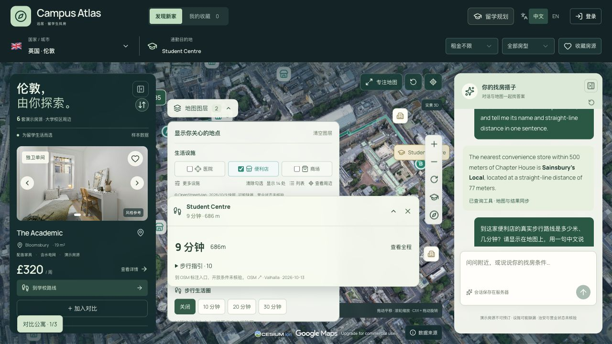
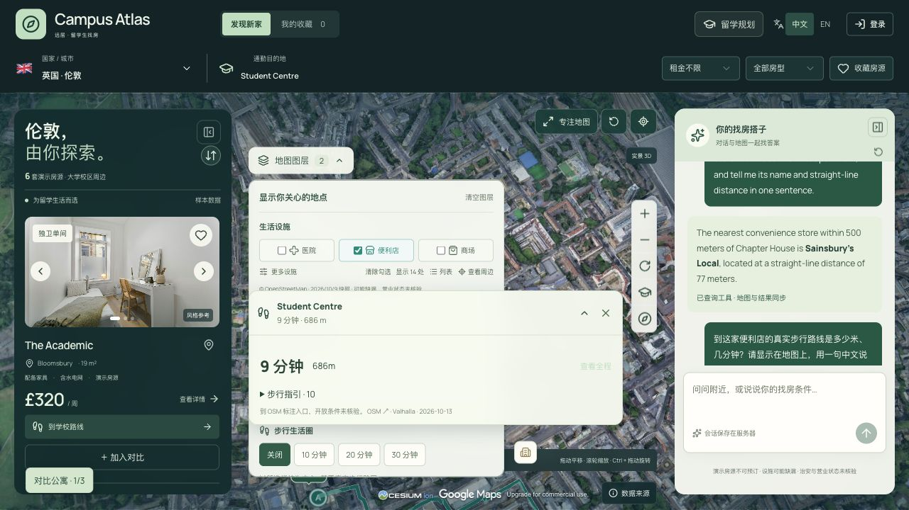

# Campus Atlas：社区需求调研与线上界面验收

日期：2026-10-14。对象：[Cloudflare 公开演示站](https://campus-atlas-demo.pages.dev)。本轮产出是调研、实测和改进建议，没有修改应用代码或重新部署。

## 结论

现有产品已经有比较完整的学生找房功能基础。当前最值得做的是：先解决地图浮层遮挡和路线取景问题，再把已有计算结果放到用户做决定的位置，最后补齐房源可信度与收藏决策流程。继续增加零散按钮或装饰动效，收益低于这三项。

本轮确认 **2 项影响核心操作的问题、4 类可用性或视觉问题**。基础浏览、筛选、游客返回和中英文 AI 地图联动走通；这不等于全站、所有城市、所有设备均已验收通过。

## 1. 调研方法与证据边界

- 检索并阅读 Reddit、The Student Room 和 X 原帖；结合 Airbnb 官方产品发布说明及设计实践文章。来源清单在文末。
- 社区发帖是定性线索，不是代表性调查。来源时间横跨 2022—2026 年；特别是 X 上的 Airbnb 产品反馈串发布于 **2023-05-03**，用于研究成熟交互模式，不称为 2026 年的新趋势。
- 在公开站实际操作并保存截图。视口：1440×900、1280×720、1024×768、390×844、360×800；中英文均有覆盖。
- 主要业务链路在伦敦测试，初始桌面状态观察了曼彻斯特，窄屏查看了英国五城市选择界面。没有在本轮重复完整测试全部 11 城市。
- 源码定位基于本地版本 `02e619b0ff86729689d6bb7c5b9f393941f0053a`。线上截图是线上行为证据；源码说明是排查依据，不将候选原因冒充已修复验证的根因。
- 房源和租金仍为演示数据；设施来自地图数据/快照，不等于现场核验。没有核实真实可租状态、店铺营业或治安水平。

## 2. 社区关注什么，对本项目意味着什么

| 关注点 | 来源中的具体信号 | 本项目建议 | 优先级与依赖 |
|---|---|---|---|
| 实际负担，而不只是周租 | X/Airbnb 的总价反馈；学生论坛讨论取暖、账单和房屋条件 | 在房源卡增加月度总支出摘要；一次性费用、押金单列；未知费用显示“待确认”；显示当前假设 | 高。复用已有费用引擎，不再做一套计算器 |
| 国际学生能否签下来 | UniUK 国际学生遇到担保人门槛 | 房源条件明确列出担保人要求、租期、入住日期、付款条件和适用范围；未知项不自动判定符合 | 高，但需要房源方提供资料。论坛中的法律说法不作为本项目规则 |
| 图片、地址、联系人是否可信 | Melbourne 讨论中出现低价、无法看房、催交押金；Study Melbourne 提醒核实租住信息 | 增加房源来源、最后核验时间、原始链接、照片/户型资料、联系人核验状态 | 高。演示房源维持“未核验”，不能添加虚构的认证徽章 |
| 住进去之后是否好住 | The Student Room 看房讨论提到通风、霉菌、取暖与维修 | 做个人看房核对清单：采光、通风、噪声、供暖、网络、账单上限、维修反馈；允许记录照片、日期和备注 | 中。先做个人记录，不包装成平台评分 |
| 看地图时不要丢掉上下文 | X 的地图反馈关注标记消失；房产论坛反馈切换地图/列表后过滤条件或位置丢失 | 保留所选房源、筛选和地图位置；搜索范围变化明确告知；选中的点始终可识别 | 高。本项目已有部分能力，重点是修复浮层和取景 |
| 收藏之后如何作决定 | X 愿望单笔记；房产讨论中的重复房源和来源问题 | 在现有收藏、对比、分享之上，补“待看房/待确认/已排除”、个人备注和排除理由 | 中。优先增强现有链路，不新建另一套收藏系统 |
| 及时知道有新房，又不被打扰 | HousingUK 对即时提醒的需求与通知疲劳并存 | 真实房源接入后做保存搜索，频率可选即时/每日/关闭，附触发原因 | 后置。当前每城只有少量演示房源，提醒价值有限 |

### 已有能力，避免重复建设

源码与界面均已确认现有留学规划包括校园楼栋、入住日期/租期、费用估算、每周多个目的地和交通规划入口；公寓对比已有月租、费用、押金、步行、周通勤和分享链接等信息。

因此，下一轮真正有价值的增量是：

1. **房源决策摘要**：卡片直接显示“到所选楼栋步行约多久、月度费用已知多少、哪些条件符合/待确认”。AI 推荐同步给理由，不用一个不透明的匹配分数替代事实。
2. **可信度资料卡**：来源、更新时间、可租状态、担保条件、照片与户型资料。数据缺失本身要可见。
3. **收藏决策记录**：待看房、待确认的问题、个人备注、排除理由。分享时不要附带私聊内容。
4. **看房清单**：围绕噪声、通风、采光、网络和费用记录观察。距离铁路/道路可以做有来源的提示，不能据此宣称“安静”或“安全”。

“地图范围内搜索”、更多筛选条件和新房提醒可在真实库存接入后做。当前没有必要靠增加筛选层级来处理每城六套演示房源。

## 3. 线上验收步骤与健康状态

| 步骤 | 操作与观察 | 健康状态 | 证据 |
|---|---|---|---|
| 1 | 桌面进入地图、查看房源和楼栋路线，展开图层 | **存在核心遮挡**：基础加载正常，图层与路线卡相互争夺空间 | [02](evidence/2026-10-14-product-audit/02-desktop-route-1440.png)、[03](evidence/2026-10-14-product-audit/03-desktop-layers-1440.png)、[04](evidence/2026-10-14-product-audit/04-desktop-layers-route-1280.png) |
| 2 | 展开图层时点击“查看全程”，再进入专注地图 | **取景需修复**；面板收放本身可用，专注状态路线卡偏大 | [05](evidence/2026-10-14-product-audit/05-route-fit-1280.png)、[06](evidence/2026-10-14-product-audit/06-focus-map.png) |
| 3 | 英文规划面板、费用页；缩到手机视口 | **本次通过**：表单可滚动，费用信息显示正常 | [07](evidence/2026-10-14-product-audit/07-planner-en-1280.png)、[08](evidence/2026-10-14-product-audit/08-costs-en.png)、[09](evidence/2026-10-14-product-audit/09-costs-mobile-en.png) |
| 4 | 手机切换 Homes / City / Assistant，展开地图图层及路线 | **地图状态不通过**：浮层覆盖大部分地图；普通房源列表可浏览 | [10](evidence/2026-10-14-product-audit/10-mobile-map-en.png)、[11](evidence/2026-10-14-product-audit/11-mobile-map-collapsed.png)、[12](evidence/2026-10-14-product-audit/12-mobile-homes-en.png) |
| 5 | 预览公寓、打开完整详情、进入登录、游客返回 | **功能走通，视觉待统一**：游客返回保留详情路径及楼栋/对比参数；详情页与登录页仍是旧主题 | [13](evidence/2026-10-14-product-audit/13-detail-mobile-en.png)、[14](evidence/2026-10-14-product-audit/14-detail-page-mobile-en.png)、[15](evidence/2026-10-14-product-audit/15-login-mobile-en.png) |
| 6 | 添加第二套公寓、横向滚动对比、移除新增项 | **功能走通，手机比较困难**：滚动后比较项名称离开视野 | [16](evidence/2026-10-14-product-audit/16-compare-mobile-en.png)、[17](evidence/2026-10-14-product-audit/17-compare-mobile-scrolled.png) |
| 7 | 设置预算，再选房型得到空结果，点击重置 | **功能通过，样式待统一**：1 套→0 套→恢复 6 套；空状态与筛选条沿用蓝白样式 | [18](evidence/2026-10-14-product-audit/18-mobile-empty-state.png) |
| 8 | 英文 UI 发中文问题，再切中文 UI 发英文追问 | **本次通过**：回复语言跟随消息；地图设施数从 33 变为 1，地点名和距离与回复一致 | [20](evidence/2026-10-14-product-audit/20-ai-map-count-mobile.png)、[21](evidence/2026-10-14-product-audit/21-ai-bilingual-reply.png) |
| 9 | 360px 英文国家/城市弹窗，Escape 关闭；1024px 地图 | **本次所查状态可用**：长校名换行，弹窗内容滚动，Escape 可关闭；地点卡仍占较大地图面积 | [22](evidence/2026-10-14-product-audit/22-city-picker-360-en.png)、[23](evidence/2026-10-14-product-audit/23-uk-cities-360-en.png)、[24](evidence/2026-10-14-product-audit/24-tablet-map-1024-en.png) |

费用页观察到 £385/周换算为 £1668.33/月；未知费用保留未知，不视作 0。手机列表状态的文档宽度与视口同为 390px，未观察到整个页面横向溢出。

本轮新增的两条 AI 验证消息：

- 中文：“请查询当前公寓直线500米内有几家便利店，并在地图上显示，用一句中文回答。”回复当前 Union Rooms 周边收录 33 家；地图图层显示 33 处。
- 英文追问要求只显示最近一家。回复 The Convenience Store、直线 100 米；地图显示 1 处，地点信息卡名称和距离一致。

这证明本次语言切换、上下文和结果同步链路可用，不代表 33 家均已现场核验、都营业或都在当前屏幕中。两条验收消息保留在该访客会话中；临时标签页已关闭，尺寸模拟和语言已恢复。最终读取该验收标签的已捕获浏览器 error 日志为空；未做完整网络错误/性能审计。

## 4. 已确认的问题与修复验收条件

### F1 · P1：展开的图层被路线摘要挡住

**复现**：伦敦选中 Chapter House 与 Student Centre 楼栋，显示步行路线，同时展开地图图层。1440×900、1280×720 和 390×844 都能观察到重叠。

1440 视口下，20/30 分钟步行圈按钮中心的 `elementFromPoint` 命中路线摘要的 `button.journey-toggle`，而不是按钮本身；1280 截图中校园控制区被路线卡盖住。手机上路线卡遮住设施与校园选项，地图仅剩零碎区域。

**排查依据**：`app/app/design-lab/design-lab.css` 第 141 行图层 `z-index:4`，第 530 行路线壳 `z-index:5`；第 564—565 行图层高度虽按地图容器计算，但没有扣除展开的路线卡占用区域。单纯调高图层 z-index 会转而遮挡路线。

**建议**：统一管理地图浮层布局；桌面根据真实剩余高度滚动，空间不足时折叠次级面板；手机采用一个主要底部面板，图层、路线、地点详情互相切换。

**验收**：三种已复现尺寸下，图层每个选项可见可点，路线展开/折叠均无控制遮挡，地图仍保留可操作区域；关闭任一面板不清空查询结果。

### F2 · P1：点击“查看全程”后路线仍落在可用视野之外

**复现**：在 F1 的 1280×720 状态点击“查看全程”，等待相机移动结束。起点及路线被推到地图底边，终点不在无遮挡的有效区域内。专注地图状态也观察到路线靠底部、大片空间被摘要占用。

**排查依据**：`app/components/design-lab/route-display.ts` 第 12—25 行由图层底部和路线卡顶部计算可用范围，但 `freeBottom = Math.max(freeTop + 85, …)` 在浮层已重叠时仍会构造至少 85px 的区域；第 45—46 行据此再次平移相机。这是与现象一致的重点排查方向，尚未通过代码修改验证完整根因。

**建议**：先解决浮层布局，再让路线取景读取实际无遮挡矩形；空间不足时先折叠次级面板，不向视口外虚构空间。容器尺寸或面板状态改变时应重新核对可见性。

**验收**：用户点击“查看全程”后 A/B 端点和路线主体同时位于无遮挡区域；在三种尺寸、左右面板收放、图层开关和路线折叠组合下均成立；用户拖动应能中断飞行动画。

### F3 · P2：手机对比表能滚动，但比较上下文会丢失

390px 屏幕初始只看到比较项与一套公寓，第二套在右侧；向右滚动后比较项名称离开视野。不是数据丢失，而是读表时需要反复横移。

**排查依据**：`design-lab.css` 第 503、506 行：表格桌面最小宽 600px，手机最小宽 580px；表头 sticky，首列未固定。

**建议与验收**：手机改为两套并排的简短指标卡，或保留表格并固定比较项首列、明确横滑提示和当前列位置。横向切换时始终知道正在比较租金、押金还是通勤。保留现有分享与移除功能。

证据：[初始视图](evidence/2026-10-14-product-audit/16-compare-mobile-en.png)、[横向滚动后](evidence/2026-10-14-product-audit/17-compare-mobile-scrolled.png)。

### F4 · P2：B 方案没有覆盖完整用户流程

首页、地图和公寓预览已采用深绿 B 方案；进入完整详情与登录后回到旧蓝白风格，筛选条和空结果按钮也保留旧样式。产品在页面跳转时缺乏连续感。

**排查依据**：完整详情与认证页面继续使用 `app/app/globals.css` 中的 `.listing-detail-page`、`.auth-*` 等样式；首页 B 方案主要限定在 `.concept-lab` 内。还有部分旧 `.active-filters` 样式被直接复用。

**建议与验收**：将语义色、字体层级、按钮、边框和空/错/加载状态统一到共享设计变量。详情、登录、注册、重置筛选在中英文与手机尺寸下保持同一套视觉语言，不影响表单与返回地址。

证据：[绿色预览](evidence/2026-10-14-product-audit/13-detail-mobile-en.png)、[蓝白完整详情](evidence/2026-10-14-product-audit/14-detail-page-mobile-en.png)、[登录](evidence/2026-10-14-product-audit/15-login-mobile-en.png)、[空结果](evidence/2026-10-14-product-audit/18-mobile-empty-state.png)。

### F5 · P2：专注地图仍被过宽的信息卡占据

1280px 专注模式下，路线摘要横跨约 1184px、约 190px 高；实际信息量很少，主要内容聚在左侧。1024px 的地点信息卡也横占大部分地图。

**建议**：桌面摘要限制合理最大宽度，默认展示目的地、时间、距离和展开入口；详细转向指引按需打开。移动端用底部面板的紧凑/展开两态。宽度可以先以 400—480px 作为设计试验值，再按实际内容验证。

**验收**：专注地图后可见地图面积明显增加，摘要仍可读，地点和路线操作没有重复入口。证据：[专注模式](evidence/2026-10-14-product-audit/06-focus-map.png)、[平板地点卡](evidence/2026-10-14-product-audit/24-tablet-map-1024-en.png)。

### F6 · P2/P3：次要信息过小，旧色值降低可读性

部分提示只有 8—10px；样式中 `.list-meta` 为 9px、`.demo-photo` 为 8px。空结果的 Reset filters 实测为 13px、蓝色 `rgb(52,92,240)`，在当前深色背景中视觉弱；清除条件控制为 11px。详情英文还存在 `internet.For` 缺空格的文案问题。

**建议**：正文优先 14px 以上，次级说明尽量 12px 起；重要可点击项增加触控范围和清晰的焦点状态。正文大小是设计目标，不等于本轮已经测定无障碍合规。地图服务署名仍遵守供应商要求，不以进一步缩小或隐藏来换空间。

**验收**：长英文、空状态、筛选条件、地图说明在手机和桌面均可读；针对实际前景/背景重新测对比度、键盘焦点与触控命中范围。本轮未做完整 WCAG 审计。

## 5. 样式与动效方向

保留 B 方案的绿色、真实城市和空间感，重点提升一致性、信息层级与状态反馈。Emil Kowalski 的文章强调高频操作并不都需要动画；应将动画用于解释关系，避免拖慢操作。

建议的第一轮参数是设计起点，并非已测得最佳值：

- 普通按钮、选项和浮层开合约 150—220ms；筛选结果立即更新，不加仪式性的等待。
- 选中房源时，卡片、地图标记同步产生一次短暂强调；不要让大量标记持续呼吸或跳动。
- 相机移动服务于定位，支持中断；用户频繁切换时取消过时飞行，不排队播放。
- AI 地图变更增加简短“已显示 1 家便利店 · 查看地图”反馈；手机用户不必自己猜测 City 标签发生了什么。
- 重要的时间、距离、月度费用以数字与来源为主，减少无信息价值的装饰徽章。
- 全站延续 reduced-motion 支持。源码中的路线飞行已读取该偏好；本轮没有完成系统级减少动态效果实测。

## 6. 建议执行顺序

1. **修可靠性**：F1 浮层协调 → F2 路线取景 → F3 手机对比。先让现有功能稳定可用。
2. **统一视觉**：F4 全流程主题 → F5 紧凑摘要 → F6 字号、对比度与触控区域。覆盖普通、空、加载、失败和英文长文本状态。
3. **提升找房决策**：把现有费用与楼栋通勤摘要前置，补收藏备注和看房清单。
4. **有真实数据再增强**：房源可信度、可租状态与来源更新、保存搜索提醒。现阶段不添加虚构核验标记。

补充观察：登录页没有展示“忘记密码”入口；正式面向真实账号使用前，应验证密码找回与邮件验证链路。本轮没有注册、修改密码，也没有测试认证后端的恢复能力。

## 7. 尚未验收的范围

- 真机 Safari/Android 键盘、低性能 GPU、弱网与长时间使用性能。
- 完整键盘操作和屏幕阅读器；本次只抽查城市弹窗 Escape 关闭。
- 全部 11 城市逐一的路线、楼栋和设施覆盖；公共交通供应商可用性。
- 注册、邮箱验证、密码恢复与登录后跨设备持久化。
- 第三方设施和房源的现实准确性、安全状况、营业状态。

本次没有代码改动，因此没有为研究文档运行应用测试或构建；观察到的 UI 问题均待后续实现后重新验收。报告不构成“功能全部无问题”或“已修复上线”的结论。

## 8. 来源清单

以下均于本轮检索/阅读；访问日期 2026-10-14。X 的具体原帖已通过浏览器打开，地图反馈原帖截图保存在 [source-x-map-feedback.png](evidence/2026-10-14-product-audit/source-x-map-feedback.png)。只保留研究相关摘要，不归档整篇第三方内容。

| 编号 | 来源 | 时间与证据用途 |
|---|---|---|
| S1 | [X：Brian Chesky，总价显示](https://x.com/bchesky/status/1653737612807372803) | 2023-05-03；成熟产品对隐藏成本反馈的回应，不是本轮用户调查 |
| S2 | [X：愿望单与笔记](https://x.com/bchesky/status/1653738138009780224) | 2023-05-03；收藏后的协作和决策记录 |
| S3 | [X：地图速度、标记数量与平移缩放](https://x.com/bchesky/status/1653738689313353729) | 2023-05-03；地图反馈连续性，原帖可见且已截图 |
| S4 | [Airbnb 官方：2023 Summer Release](https://news.airbnb.com/airbnb-2023-summer-release-highlights) | 2023；交叉核对总价、愿望单、地图等产品改变。短租做法需适配学生长租，不能直接照搬 |
| S5 | [Reddit / UniUK：没有英国担保人](https://www.reddit.com/r/UniUK/comments/1s3bcue/uk_accommodation_asking_for_guarantor_but_i_dont/) | 2026-03-25；国际学生签约门槛。评论中的法律建议不当作权威规则 |
| S6 | [Reddit / Melbourne：低价房源是否诈骗](https://www.reddit.com/r/melbourne/comments/1him29v/is_this_a_rental_scam_too_good_to_be_true_rental/) | 2024-12；无法看房、押金压力和来源核验。个案不代表市场比例 |
| S7 | [Study Melbourne：租房权益与注意事项](https://studymelbourne.vic.gov.au/living-here/accommodation/your-rights-when-renting) | 官方学生信息；作为核实信息和租房风险提醒的来源，不在本报告展开法律指导 |
| S8 | [The Student Room：House Viewings](https://www.thestudentroom.co.uk/showthread.php?t=7695364) | 发帖日期未可靠确认；取暖、通风、霉菌等看房核对项 |
| S9 | [Reddit / BEReal_Estate：房产地图更新反馈](https://www.reddit.com/r/BEReal_Estate/comments/1wk238v/imino_has_a_new_map_more_results_and_better/) | 发帖日期未可靠确认；切换后丢条件/地图位置、来源和信息拥挤的反馈 |
| S10 | [Reddit / HousingUK：即时房源提醒](https://www.reddit.com/r/HousingUK/comments/x93yvx) | 2022-09-08；提醒价值与通知疲劳的不同观点 |
| S11 | [Reddit / UXDesign：地图搜索范围讨论](https://www.reddit.com/r/UXDesign/comments/10rsbu6) | 2023-02-02；是否增加范围筛选要考虑库存量，不把建议当普遍规则 |
| S12 | [Emil Kowalski：You Don't Need Animations](https://emilkowal.ski/ui/you-dont-need-animations) | 设计者原文；高频操作、速度与有目的的动画 |

## 9. 证据索引

截图目录：[`evidence/2026-10-14-product-audit/`](evidence/2026-10-14-product-audit/)。编号对应上方验收表。另有 [01 初始曼彻斯特桌面](evidence/2026-10-14-product-audit/01-current-desktop.png) 和 [19 英文手机助手](evidence/2026-10-14-product-audit/19-mobile-chat-en.png)。原始截图未作美化或替换；暂态加载画面已在相关页面稳定后重截。
