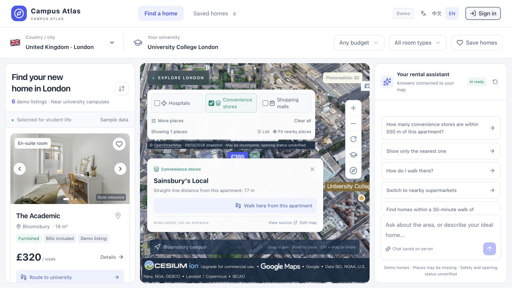
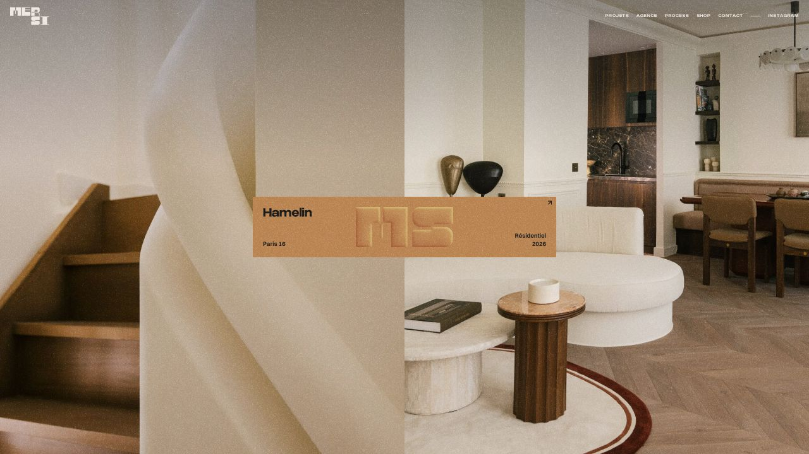

# Campus Atlas 界面质感与动效调研

调研日期：2026-10-13。任务：围绕“上一版变化不够明显”，查找社区讨论、设计师作品和可迁移的动效方法，为下一版确定视觉方向。

这次完成研究与参考案例核对，没有修改应用代码或重新部署。使用 Exa 做了 9 组检索，请求 66 个结果位，实际返回 61 条候选记录，去重后 52 个链接；另用定向搜索补查 Reddit、X 和技术文档。这些数量是候选数，不代表全部深读。最终采用的 14 个来源及核对状态见 [证据清单](./evidence/premium-ui/manifest.json)。

## 1. 对当前页面的判断

当前公开站点已具备真实城市三维画面，也有清晰的三栏功能。这次在 1280×720 下对照了当前界面：

从这张截图看，视觉重量集中在白色圆角容器、边框和标签上：左右两栏与地图内浮层都使用相近的盒子，缺少主次鲜明的材质关系。地图上方的设施筛选、地点详情和底部提示占据较多画面，城市本身的表现力被遮住；字体、摄影和品牌形状也尚未形成足够独特的组合。这是本次的设计判断，不是性能或可用性测试结论。

上一轮的间距、按钮反馈和状态修整有助于一致性，但用户看到的构图和视觉身份变化有限。下一轮应先定义完整画面，再从中提炼组件与参数。

Reddit 有一个很接近的讨论：作者已经制定颜色、字号、圆角和组件，仍觉得网站像模板。评论分别指出重复盒子、缺少字号对比、图片与业务脱节等问题，也有人主张更强的配色。它说明了值得检查的症状，不能当成社区一致结论。[原帖与评论](https://www.reddit.com/r/webdesign/comments/1uvohqw/i_built_a_design_system_so_why_does_my_website/)

## 2. 最值得参考的作品

| 参考 | 已核对的内容 | 适合迁移到我们网站的部分 |
| --- | --- | --- |
| [MERSI 实际网站](https://www.mersi-architecture.com/) / [作者案例](https://tympanus.net/codrops/2026/07/27/between-print-and-digital-the-making-of-mersis-website/) | 阅读制作说明；打开首页并点击 Hamelin 进入详情 | 大幅室内摄影、暖色材质、强字号对比，以及图片延续到详情的空间关系 |
| [Spain Collection 制作案例](https://tympanus.net/codrops/2025/12/18/spain-collection-evolving-a-luxury-website-into-a-digital-ecosystem/) | 作者讲述旅行目录、视觉系统和交互实现 | 城市选择与登录页的旅行氛围；图片、文字与筛选的统一设计 |
| [Linear 的 Liquid Glass](https://linear.app/now/linear-liquid-glass) | 阅读原团队实现说明 | 地图操作浮层的半透明材质、边缘高光、细阴影和清晰层级 |
| [Rauno：Designing Depth](https://rauno.me/craft/depth) | 阅读原作者的层次与编排分析 | 背景、内容、浮层三层关系；打开详情时让背景退后，重点自然进入前景 |
| [Emil：Good vs Great Animations](https://emilkowal.ski/ui/good-vs-great-animations) | 阅读并实际点击标签示例 | 选中背景连续移动；文字颜色同步；弹层从触发位置展开 |
| [Interfere：新网站如何设计与实现](https://interfere.com/blog/how-we-built-interferes-new-website) | 阅读团队原文，从社交检索追溯到作者资料 | 先探索完整视觉方向，选出贯穿各页面的特征；动效按内容分组，有节奏地呈现 |

MERSI 的实际首页参考：

它展示的暖色、摄影和排版是一套完整表达。我们可以借鉴图文关系与连续过渡，但学生找房的价格、通勤和筛选需要更直接；官网的超小导航和较长转场不适合照搬到主工作界面。

Linear 的玻璃实现由背景模糊、渐变、高光和阴影组合而成，作者同时解释了为什么没有采用折射：密集信息的可读性更重要。这是原生 iOS 实现，网页应重新设计轻量版本，不能把其 shader 直接当作 CSS 方案。[原文](https://linear.app/now/linear-liquid-glass)

X 检索发现了 Jakub Krehel 关于 Interfere 双层侧栏过渡的作品。此次 [X 原帖](https://x.com/jakubkrehel/status/2048788140849062241) 返回 403；只读到了 [MotionVault 存档](https://motionvault.dev/jakubkrehel/status/2048788140849062241/) 的描述。因此不声称看过原视频、验证了完整动效或其热度。更可靠的依据是上表中团队自己发布的制作文章。

## 3. 推荐的三个视觉方向

以下是结合来源提出的设计方案，不是来源已经为 Campus Atlas 验证过的结果。

| 方向 | 视觉表现 | 最适合的效果 | 对我们的适合度 |
| --- | --- | --- | --- |
| A：现代城市生活指南 | 暖白、石灰、深墨色；精选室内/街区摄影；清晰而有性格的标题；地图占据视觉中心 | 图片连续进入详情、城市切换的短暂揭幕、轻微纸张纹理 | **推荐作为主方向**。有居住温度，仍适合快速筛房 |
| B：空间感地图工具 | 冷白或浅雾色底；地图上的半透明工具条；细高光边缘；选中对象明显浮到前景 | 相机取景变化、轻玻璃、地图标记和路线的连贯出现 | 推荐作为 A 的交互与地图材质补充 |
| C：电影感城市探索 | 深色界面、城市摄影、较强明暗与光泽 | 登录页的慢速镜头、轻微光影变化、城市封面揭幕 | 更适合登录/城市入口；三栏长时间阅读需单独验证 |

建议组合 **A 的摄影与排版 + B 的地图材质和空间动效**。让人一眼感到变化的地方应是画面比例、图片气氛、字体层级与浮层质感，而不是仅调整圆角或按钮颜色。

具体到三栏：左侧房源以图片、价格和通勤信息为核心，减少同等显眼的标签；中间保留实景城市，统一设施工具条与地点卡的视觉关系；右侧 AI 采用清楚的对话节奏与结果摘要，降低首屏连续大按钮对画面的占用。所有筛选、示例问题和操作继续可达，保留中英文及原有移动端切换方式。

## 4. 值得做出明显变化的动效

下列时间是下一版的初始设计目标，需要在真实界面中调整，不是测试结果。

| 场景 | 用户应该看到什么 | 建议起点与约束 |
| --- | --- | --- |
| 房源进入详情 | 点击的图片从原位置延续到详情大图；关闭时回到原卡片，列表滚动位置保留 | 约 350–500ms；可中断；不把正文拉伸变形 |
| 点击房源定位 | 卡片选中立即反馈，地图平滑调整取景，目标标记强调一次 | 当前项目已有约 1.4s 的相机飞行；应优化取景和三栏同步，不能把“加 flyTo”当成新效果 |
| 显示步行路线 | 路线沿真实路径短暂展开，起终点和距离/时间摘要随后就位 | 约 500–800ms 的视觉展开；真实几何、距离和耗时不变；数据未返回时只显示真实加载状态 |
| 查询 500m 内便利店 | 搜索范围边界出现一次，查询结果与地图标记对应呈现；结果数量易于读到 | 范围按真实查询定义显示；不能把直线半径画成步行可达范围；不做持续闪烁 |
| 设施筛选与语言切换 | 选中背景连续滑动，文字颜色同步变化；展开菜单从对应按钮生长 | 约 160–240ms；中英文长文本同时设计 |
| AI 调用工具 | 显示正在查询哪类信息，完成后摘要、地图标记和路线协调更新 | 只反映实际工具状态；流式正文保持阅读稳定，用户回看历史时不强制滚动 |
| 登录/城市入口 | 城市大图带轻微镜头运动，文字分组出现，背景有很轻的静态颗粒 | 初次出现约 500–800ms；镜头幅度小；操作表单保持稳定；减少动态效果偏好下静止 |
| 地图浮层材质 | 柔和阴影、细高光边缘与适量透景；选中层略高于基础工具层 | 控制在少数小面积浮层；正文使用足够实的背景；需要实测和 Cesium 同屏的代价 |

房源图片到详情、选房到地图取景、查询到路线展开，最有机会成为这个产品自己的记忆点。它们都来自用户已经在做的核心操作。

Emil 的公开演示解释了触发位置、曲线和同步色彩的关系；Rauno 的文章则强调层次与出现顺序。两者为上述连续过渡提供依据。[Emil](https://emilkowal.ski/ui/good-vs-great-animations)、[Rauno](https://rauno.me/craft/depth)

## 5. 特效应该放在哪里

- **磨砂玻璃与边缘光**：用于地图工具条、浮动地点卡和移动端操作层；房源价格和长篇对话保持清晰的实体表面。
- **轻微颗粒与图片色调**：用于登录页、城市封面等展示区域；颗粒优先静态纹理，不覆盖需要辨认的真实地图。
- **局部景深**：打开详情或弹窗时适度降低背景显著性，帮助用户感知前后关系；避免在实时三维地图上持续做大面积模糊。
- **短暂扫描/范围扩散**：只在用户发起附近查询时出现一次，用实际查询边界承载效果。
- **有节奏的图片揭幕**：适合城市入口和首次进入；常用筛选操作仍应立即可见。
- **光泽跟随或轻微视差**：可在登录页单一视觉对象上试验，移动端不依赖悬停。

Reddit 对动效没有统一态度：有人支持叙事和惊喜，也有人反感反复滑入、延迟显示内容和滚动被控制。我们的设计取舍应是把显眼动效集中在核心状态转换和入口展示，避免让每次浏览都等待同一段演出。[讨论原帖](https://www.reddit.com/r/web_design/comments/1d91whv/what_is_your_opinion_on_the_aesthetic_of_web_page/)

## 6. 技术落地判断

- 日常颜色、按压、轻浮起、静态材质继续使用 CSS。
- 房源图片与详情的连续过渡优先评估 **Motion for React**，其 layoutId 支持跨组件共享元素；滚动列表、固定弹层的测量需考虑 layoutScroll / layoutRoot。适合现有 React 项目。[官方文档](https://motion.dev/docs/react-layout-animations)
- **GSAP Flip** 适合更复杂的编排，但应与 Motion 选择一个作为主要布局动画方案。没有必要为同一组交互并装两套体系。[官方文档](https://gsap.com/docs/v3/Plugins/Flip/)
- 原生 **View Transition API** 可以作为候选增强路径，落地时检查目标浏览器支持，并保留普通跳转。[MDN](https://developer.mozilla.org/en-US/docs/Web/API/View_Transition_API)
- 城市取景继续由现有 **Cesium Camera** 控制。DOM 动效库负责界面，Cesium 负责三维相机；保持同一个地图实例，避免切换详情或筛选时重建地图。[官方文档](https://cesium.com/learn/cesiumjs/ref-doc/Camera.html)
- 本次没有安装这些依赖，没有性能测量，也没有宣布路线渐进绘制或材质效果已实现。

## 7. 下一轮怎样交付更容易判断

先做两张同内容、同屏幕尺寸的高保真方向稿：A 的城市生活指南版，以及 A+B 的空间材质版；展示真实三栏、房源图片、AI 内容和地图浮层，避免只用登录页代表整个产品。

再做一个可操作样片：**选择房源 → 图片展开到详情 → 返回原卡 → 显示到学校的真实路线**。这段样片同时检验视觉身份和实际交互手感，适合先判断“是否明显更有质感”。

选定方向后再覆盖全站；验收应包含中英文的 1280/1440 桌面与 390 手机布局、键盘/触屏操作、减少动态效果设置、连续快速切换时可中断、列表和对话滚动位置、地图不重建，以及现有真实路线与设施查询仍正常。演示房源声明、地图来源署名和数据局限继续清楚展示，不添加虚构的安全评分、路线或数据状态。

本轮阅读和截图支持设计研究结论；不构成已实现、已部署、已通过性能测试或已证实提升转化率的结论。参考截图仅用于调研，品牌、照片及作品版权仍属于原作者。
