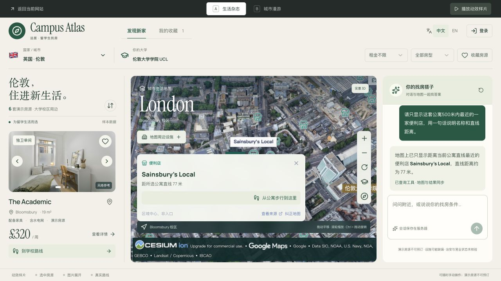
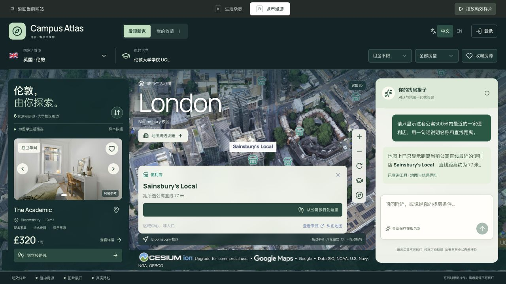
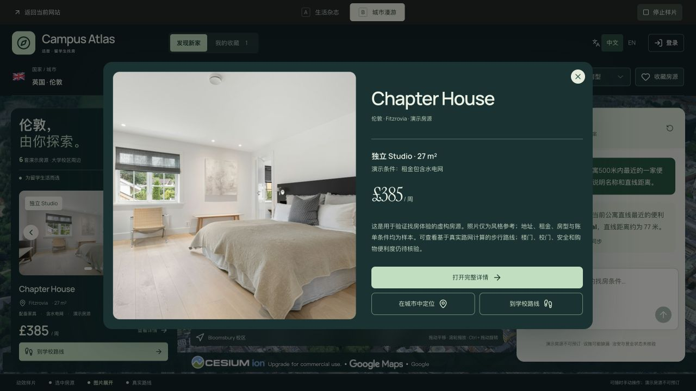

# 两套视觉方案与交互动效样片

2026-10-13。入口：`http://localhost:5174/design-lab?city=london&variant=editorial`。

这是一条独立的本地预览路线。原首页、登录、API、共享功能组件及线上部署没有被本轮改写。预览中的 AI 和地图使用项目现有配置，正常调用会使用对应服务账户的额度。

| 方案 | 视觉方向 | 主要差异 |
| --- | --- | --- |
| A · 生活杂志 | 暖白、深绿、建筑摄影、较大的衬线标题 | 平面的房源栏、带画框感的地图、纸张色调的对话区域 |
| B · 城市漫游 | 深色外壳、浅绿操作色、无衬线字、浮动面板 | 实景城市铺满工作区，两侧面板悬浮在地图上，材质与层次更明显 |

点击顶部 A/B 即可原位对比，地图组件保持挂载。右上角“播放动效样片”会选择当前结果中的第二套房源（仅一套时使用第一套），展示图片进入详情、收回图片，再显示到大学的真实路线。可以停止播放，也可以直接手动操作。它是可操作的网页样片，不是录制视频。

图片过渡采用 Web Animations API，约 280ms；路线按原有经纬度逐段显现，约 900ms。遵循减少动态效果设置。相机继续使用 Cesium；路线距离、时长、转弯点和高程取样逻辑来自既有实现。

保留的操作：国家/城市、预算/房型、价格排序、收藏与取消、图片切换、详情与完整详情链接、定位、缩放/旋转/回校、真实路线、设施勾选及更多设施、真实 AI 对话与地图联动、中英文切换、原登录入口。手机仍使用房源/城市/助手面板切换。

图片继续使用项目已有风格参考照片，并保留演示声明。没有复制调研网站的摄影或商标。新增字体自托管，字体来源及 OFL 许可见 `app/public/fonts/design-lab/sources.json`。

本轮实际核对：

- TypeScript 检查通过；Cloudflare 构建通过，构建守卫报告密钥泄露 0、SQLite 服务端导入 0、D1 存在。没有部署该构建。
- 1280×720 桌面下两套方案价格可见；390×844 手机未观察到页面横向溢出。英文手机筛选控件已核对为单行、32px 高。
- 切换图片、收藏再取消、Studio 筛选（2 套）以及设施勾选可用。
- 实际 AI 请求“显示当前公寓 500 米内最近一家便利店”返回 Sainsbury's Local，直线约 77 米；地图同步为 1 处。
- 样片完成后显示 Chapter House 到 UCL 的既有真实步行路线，844 米、约 11 分钟。
- 停止按钮、手动操作与键盘切换筛选会停止后续样片步骤；减少动态效果时图片过渡为 0s、不创建飞行图片。手机路线取景已核对起终点分开、完整路径可见。
- 定向复核完成。最终桌面补测中，两案选中设施后自动收起筛选区（可再展开），观察收起容器的实际高度；1280×720 下两案地点卡片均完整容纳步行按钮和来源行（卡片高约 172px）。
- 浏览器 warning/error 日志在此次核心流程核对时为空。

截图：

没有测量帧率、低端设备功耗或全部城市的三维覆盖；这些截图与本地核心流程验证不等于线上全量验收。两个方案均为待用户选择的候选界面，尚未作为正式全站视觉方案采用。
