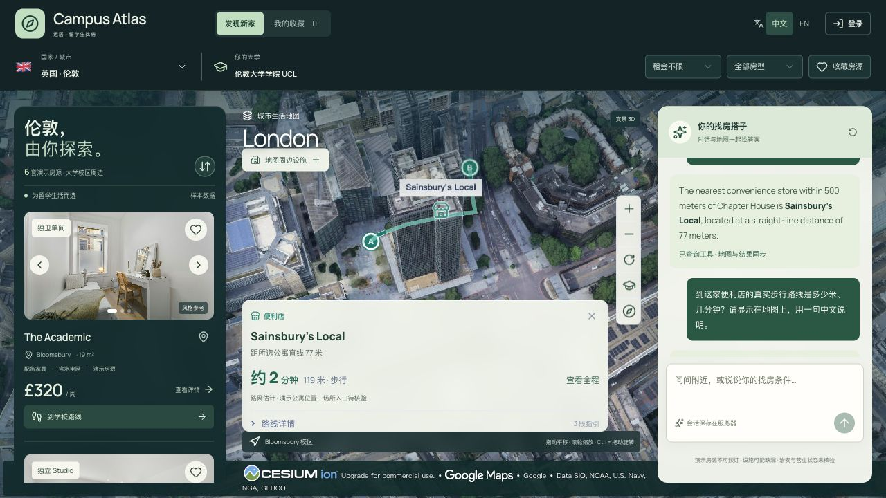
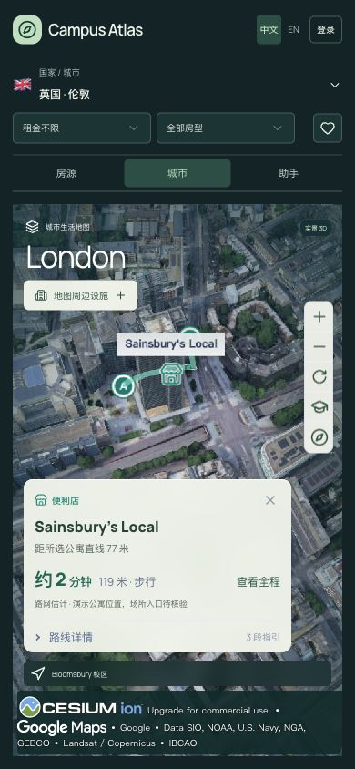

# B「城市漫游」正式应用与 Cloudflare 发布

2026-10-13。用户选择 B 并明确要求保留现有功能、部署 Cloudflare。

正式入口：[Campus Atlas](https://campus-atlas-demo.pages.dev/?city=london&listing=london-2)。

## 实现与边界

首页复用已有候选工作区，`preview=false` 固定 B：深色外壳、浅绿操作色、实景背景和两侧悬浮面板。正式页面移除 A/B 与样片播放栏，保留图片进入详情、真实路线逐段显现及减少动态效果支持。`/design-lab` 继续保留两套候选预览。

保留首次国家/城市选择、按需三维加载、预算与房型、排序、收藏、照片、详情与完整详情链接、地图操作、设施勾选、真实路线、AI 多轮、语言切换及原有登录/游客入口。正式地址继续使用 `/?city=…&listing=…&route=walk`，不会跳到候选路由。共享认证、API、D1、模型配置未修改，没有迁移或重置用户数据。

线上验证发现短距离设施路线被较高的信息卡遮挡，已修正：设施路线沿用紧凑标题和工具栏，卡片最高 190px，保留内部滚动的完整指引、收起路线及来源操作。桌面和手机均复验了地图上的路线；本地展开指引后滚动至底部，收起操作完整可见。

## 最终发布

- Worker：`12ee94e2-db29-4947-b19c-84adf7dc7a93`。
- Pages：`55fde24f`，发布地址 `https://55fde24f.campus-atlas-demo.pages.dev`；推荐继续分享固定域名。
- 更新前回退记录：Worker `e74eddcf-8820-47ce-b9b1-9e9ff42e7e70`；Pages `42cab192-5573-4248-be61-d341f3c52d21`。
- 仅更新现有免费资源，没有开通新服务或套餐；模型及地图继续使用现有账户配置。

## 证据与实际核对

| 层级 | 结果 |
| --- | --- |
| 本地 | 类型检查与最终 Cloudflare 构建通过；定向 lint 0 errors、5 warnings（4 处 img 优化和 1 处既有 Hook 依赖提示）；静态设计扫描 `[]` |
| 发布包 | `secretLeaks:0`、`sqliteImports:0`、`hasD1:true` |
| 关键操作 | 切图、收藏/取消、Studio 筛选 2 套、图片详情、校园路线、五市场选项与 Sydney→London、登录入口与游客返回原路线 |
| 尺寸/语言 | 1280×720 桌面、390×844 英文手机、644×924 面板；未观察到页面横向溢出；英文手机筛选控件 159×32px |
| 设计复核 | 本地工作区完整复核 `ship`；新增设施路线遮挡修正的定向复核为 `resolved — ship`，不扩写为全部页面审计 |
| 公网 API | 五城会话、设施/校园路线工具、D1 刷新恢复、快照文件、跨站拒绝及匿名隔离通过；[API 检查结果](evidence/hosting/spatial-production-api-2026-10-13.json) |
| 公网 AI | 英文询问最近便利店，返回 Sainsbury’s Local、直线 77m；保持英文 UI，中文追问返回中文真实路线 119m、约 2min，地图同步；共实际调用模型两轮 |
| 最终公网 | B 根页无预览控件；刷新恢复对话及设施路线；最终设施卡片 190px；浏览器 warning/error 日志为空 |

[语言及地图联动记录](evidence/spatial-production/live-chat.json)。实际设施路线使用既有 OSRM 计算/缓存，校园路径使用既有真实路网快照；没有变更距离或虚构新路线。房源仍是不可预订的演示数据。

正式设计值与范围见 [DESIGN.md](../app/DESIGN.md) 及其结构化 sidecar；字体、图片和地图署名沿用已有来源。未测量 FPS、负载、低端设备耗电或所有城市三维覆盖；本轮五城接口通过不等于五城三维画面均已浏览器复验。

