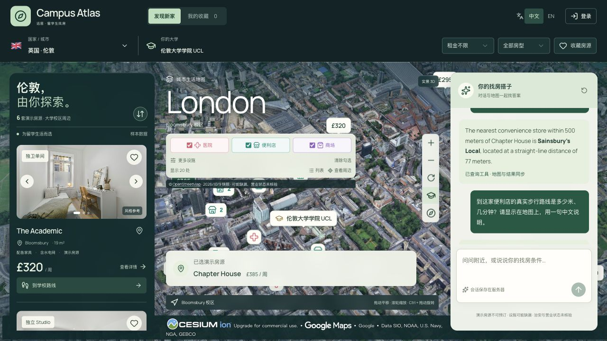
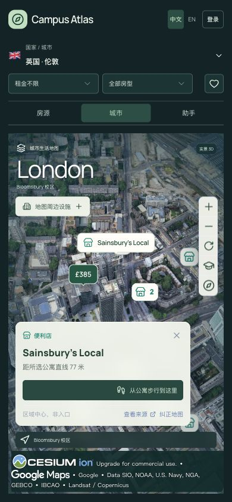
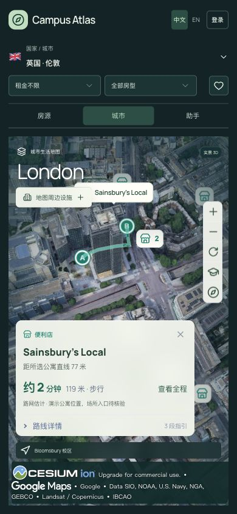

# 地图标记清晰度与 Cloudflare 发布

2026-10-13。根据用户对价格、学校及便利店标记模糊的反馈，保持已选 B 界面和原有功能，精修地图标记。

正式地址：[Campus Atlas](https://campus-atlas-demo.pages.dev/?city=london&listing=london-2)。

## 实现

价格、学校及当前所选设施名称从 Cesium 画布文字改为原生 DOM 文字与 Lucide SVG，随三维相机投影更新，整数 CSS 像素定位。价格采用 8px 圆角的小型米白徽章，当前房源以深绿色强调；学校使用简洁金色学位帽。

普通设施采用单层描边的 32px 徽章，SVG 源图为 96px；类别沿用原有图标与颜色，密集设施使用紧凑数量聚合。保留设施实体和聚合的拾取 ID。画布按原生像素密度渲染，初始化上限为 2 倍，保留硬件抗锯齿、关闭会软化图标的 FXAA。原生文字本身不依赖画布分辨率。

所选便利店名称与当前价格相碰时，避让名称徽章，保留真实地理坐标，用细引线连接。标签最多 8 个，高度采样间隔为 500ms，投影更新不触发逐帧 React 状态更新；销毁时移除监听，并防止访问已销毁 Viewer。

## 验证范围

| 层级 | 结果 |
| --- | --- |
| 本地检查 | 最终类型检查、Cloudflare 构建通过；定向 lint 0 errors、2 个既有 warnings |
| 发布包 | `secretLeaks:0`、`sqliteImports:0`、`hasD1:true` |
| 本地交互 | 原生价格点击、旋转、大学定位、三类 385 处设施、所选设施 Enter、真实路线通过 |
| 清晰度观察 | 本地 DPR 2 时画布为 2560 / 1280 CSS px；原生价格、学校与设施 SVG 清晰 |
| 独立复核 | 与用户原截图比较，清晰度与 B 风格通过；发现并修复手机标签遮挡后，定向结论为 Resolved — ship |
| 公网桌面 | 1280×720 首次加载后原生价格出现；大学定位、设施勾选与直接点击医院图标打开 University College Hospital 信息通过 |
| 公网手机 | 390×844，£385 与 Sainsbury's Local 完整可读且互不重叠，引线可见；真实步行路线仍为 119m / 约 2min |
| 公网服务 | `/api/health` 返回 database / aiConfiguration 均 ok；本轮验证标签页 warning/error 日志为空 |

首次公网检查发生在刚调整视口后，标签未出现；正常刷新并重新按需加载地图后，无需再次点击定位即可显示。未为这一未持续复现的现象虚构确定原因，未添加额外代码。

本轮没有模型调用，也未修改房源/设施数据、路线算法、后端、认证或模型配置。五城市接口与 D1 持久化沿用[前一轮证据](24-spatial-production-release.md)，本轮未重复执行完整后台回归；未声称已测帧率、所有城市三维覆盖或低端设备性能。

## 发布

- Worker：`021b26db-7fb0-4c76-a583-488ef37c0791`。
- Pages：`e111ab87`，固定域名保持不变。
- 更新前版本：Worker `12ee94e2-db29-4947-b19c-84adf7dc7a93`；Pages `55fde24f`。
- 顺序：现有 Worker 更新成功后，再发布对应 Pages 资源；未新增 Cloudflare 服务或套餐。
- 未提交或推送 Git；本地密钥仍保留在忽略配置中。

